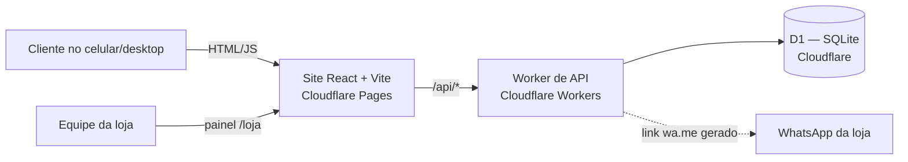

# Arquitetura — Henrique Multimarcas

## Componentes

- **Site** (`src/`): React 19 + Vite + Tailwind. Catálogo, carrinho, checkout, acompanhamento e painel da equipe.
- **API** (`worker/`): Cloudflare Worker. Produtos, cupons, pedidos, configurações e login da equipe.
- **Banco** (`worker/schema.sql`, `worker/migrations/`): D1 (SQLite gerenciado). Ambientes separados: `staging` e `production`.
- **Caixa e favoritos**: ainda no navegador (`localStorage`). Não dependem de outros aparelhos.

## Fluxos principais

1. **Compra:** site lê `/api/products` → cliente monta carrinho → `POST /api/orders` (servidor recalcula preço, promoção, cupom e frete e baixa o estoque em lote).
2. **Cupom:** `POST /api/coupons/validate` (público, não expõe a lista de códigos).
3. **Acompanhamento:** `GET /api/orders/:codigo` (sem dados pessoais), atualizado a cada 15 s.
4. **Equipe:** `POST /api/staff/login` → cookie `HttpOnly` → rotas `/api/admin/*`.

## Entidades (D1)

| Tabela | Campos principais |
|---|---|
| products | id, name, category, price, promo_price, promo_ends, stock, colors_json, sizes_json, specs_json, active |
| orders | id, status, customer_*, payment_method, delivery_type, subtotal, discount, total |
| order_items | order_id, product_id, name, color, size, price, quantity |
| coupons | code, type, value, min_order, valid_from/until, max_uses, uses, active |
| cash_sessions / cash_movements | ainda não usadas pelo site (caixa é local) |
| sessions | token_hash (SHA-256), expires_at |
| settings | key/value: `store_settings` (JSON), `staff_password_hash` |

## Segurança

- Senha da equipe: PBKDF2-SHA256, 100 mil iterações, guardada só como hash.
- Sessão: token aleatório de 32 bytes, cookie `HttpOnly; Secure; SameSite=Lax`, expira em 12 h.
- Preço e estoque nunca vêm do cliente.
- Dados pessoais do cliente só são retornados à equipe.

## Ambientes

| Ambiente | Site | API | Banco |
|---|---|---|---|
| Local | `npm run dev` (porta 3000, proxy `/api`) | `npx wrangler dev` (porta 8787) | D1 local do Wrangler |
| Staging | _a definir_ | `henrique-multimarcas-staging` | `henrique-multimarcas-staging` (criado) |
| Produção | _a definir_ | _a definir_ | _a definir_ |
